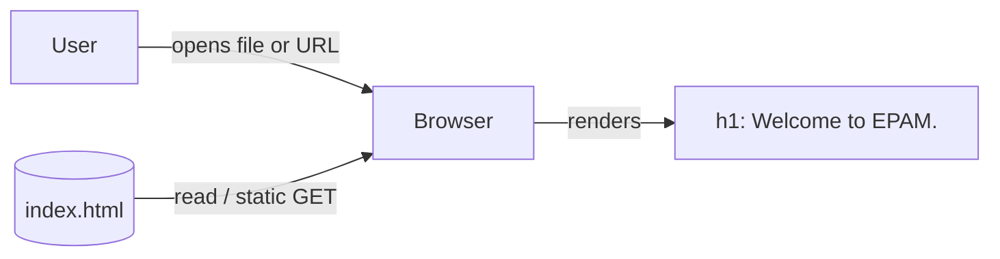

# Architecture: Welcome Page

Run branch: story/welcome-page-20261102084509-791e9e7a
Input: requirements.md (same directory)
Approval status: NOT APPROVED. Automated draft; no design review has occurred and no human approval is implied.

## 1. Overview
A single static HTML file that shows "Welcome to EPAM." when opened in a browser. There is no backend, build, script or external resource (FR-1, FR-3).

## 2. Components and Responsibilities
| Component | Responsibility | Traces to |
|-----------|----------------|-----------|
| `index.html` (repo root; A-2) | Valid HTML5 document containing the welcome text. This is the only deliverable. | FR-1, FR-2, FR-4 |
| Browser (external) | Parses and renders the file. | FR-4 |
| Static check (verification, not shipped) | Confirms the file exists, parses, contains the exact text and has no external references. | AC1-T, AC2-T |

Proposed structure of `index.html`:
- `<!DOCTYPE html>`, `<html lang="en">`, `<meta charset="utf-8">`, `<title>Welcome</title>` (placeholder, A-4), and a `<meta name="viewport" content="width=device-width, initial-scale=1">` tag (an optional extra, harmless).
- `<body>` with one `<h1>Welcome to EPAM.</h1>`. A heading is chosen because it gives clear semantics and marks the page's main message (A-3). The text is a single literal string with no whitespace variance, which keeps the exact match simple.
- No `<script>`, `<link>`, ``, `<form>`, `<a>`, inline event handlers or external fonts.

## 3. Technology Choices
- Plain HTML5. No CSS file, framework, bundler or runtime, because R3 rules out added functionality and A-1 assumes no build step.
- Default browser styling (A-5). If styling is later required, it should be a small inline `<style>` block so the page stays a single file with no extra requests. This is not planned now.
- Hosting: none specified. The file works from `file://` or any static host (A-1). Hosting is out of scope.

## 4. Data Flow

There is no user input, no state, no network call made by the page itself, and no persisted data. The only flow is file to browser to rendered text.

## 5. Trust Boundaries
- The only boundary is between the browser and the file source (local disk or a static host).
- The page has no input, no scripts and no external resources, so it handles no untrusted data and has no injection surface.
- If hosted, transport security (HTTPS) and response headers such as CSP belong to the host. They are out of scope here (assumption).
- The source story text is untrusted data. Only the literal phrase "Welcome to EPAM." is taken from it, and it is written as plain text, not interpolated into anything.
- No secrets or personal data are involved.

## 6. Failure Behavior and Limitations
| Condition | Behavior |
|-----------|----------|
| File missing, or a wrong path or name on a host | Browser or host shows its own 404 or file-not-found error. The page cannot handle this itself. |
| Wrong encoding | Mitigated by `<meta charset="utf-8">` and by using ASCII-only text. |
| Text altered, such as a missing period or wrong case | Caught by the exact-match check (AC2-T). |
| JavaScript disabled | No impact, because the page uses no JavaScript. |
| Old or unusual browser | Plain HTML5 renders everywhere in practice. No browser support target is stated (A-5). |

Limitations:
- No styling, responsive tuning or accessibility audit beyond semantic HTML (A-5).
- No error handling, monitoring or analytics.
- "Loads successfully" proves only that the file renders. It does not prove any deployment.

## 7. Testability
- AC1-T: open `index.html` in a browser (manual), or run an automated check that the file exists, is non-empty and parses as HTML. Confirm there are no external references, so no failed requests are possible.
- AC2-T: assert that the rendered text of the `<h1>` equals exactly `Welcome to EPAM.` (case-sensitive, trailing period included).
- FR-3 check: assert that no `<script>`, `<form>`, `<a>`, `<link>` or `` elements are present.
- Which approach to use (manual or scripted) is left to planning (requirements question 4). A simple script with no new dependencies is sufficient. A heavy browser-test framework would be disproportionate.

## 8. Requirement Traceability
| Requirement | Design element |
|-------------|----------------|
| FR-1 | One file, `index.html` |
| FR-2 | `<h1>` with the literal text, visible on load |
| FR-3 | No scripts, forms, links or network requests; no backend |
| FR-4 | Valid minimal HTML5 with no external resources |
| AC1, AC2 | Tests in section 7 |

## 9. Assumptions (unconfirmed)
- A-1 to A-6 from requirements.md are inherited unchanged.
- D-1: The file is `index.html` at the repo root, which matches A-2 and is the usual default for static hosts. The existing `README.md` is not touched.
- D-2: The page title is "Welcome" (placeholder).
- D-3: A heading (`<h1>`) is used rather than a paragraph.
- D-4: The viewport meta tag is included. It is optional and can be dropped if the reviewer prefers the strictest minimal page.

## 10. Out of Scope
Backend, APIs, databases, navigation, forms, interactivity, authentication, analytics, frameworks, build tooling, CI, deployment and hosting, branding, theming, localization, and an accessibility audit.

## 11. Open Questions and Decisions
1. Confirm the file name and location (`index.html` at the repo root).
2. Confirm the heading versus paragraph choice and the title text.
3. Confirm whether any styling, accessibility or browser-support expectation exists. None is assumed.
4. Choose manual or scripted verification (planning stage).
5. The repo contains other story branches from earlier runs. Whether a stale `index.html` exists on the base branch is unknown, because only this branch's working tree was inspected. The tree currently holds only `README.md` and `requirements.md`.
