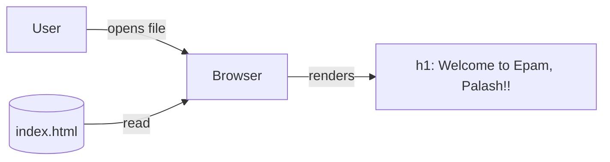

# Architecture: Welcome HTML Page (Personalized Message)

Run branch: story/welcome-html-page-20261106082359-e683a9bb
Input: requirements.md (same directory; Confluence page 786433, version 2)
Approval status: NOT APPROVED (automated draft). No design review has occurred and no human approval is implied.

Supersession notice: This document supersedes the earlier architecture for the story "Welcome to EPAM." (previous run branch story/welcome-page-20261102084509-791e9e7a). The user explicitly authorized replacing prior-run lifecycle files on this run branch; the old version remains in git history.

## 1. Overview
A single static HTML file, `index.html`, that displays "Welcome to Epam, Palash!!" when opened in a browser. No backend, build step, script or external resource (FR-1, FR-3, A-1). The existing `index.html` from the earlier story is updated in place (A-2).

## 2. Components and Responsibilities
| Component | Responsibility | Traces to |
|-----------|----------------|-----------|
| `index.html` (repo root) | Valid HTML5 document containing the welcome text. Only deliverable. | FR-1, FR-2, FR-3, FR-4 |
| Browser (external) | Parses and renders the file. | FR-4 |
| Static check (verification, not shipped) | Confirms the file parses, has the exact text and no external references. | AC1-T, AC2-T, AC4-T |

Proposed structure of `index.html`:
- `<!DOCTYPE html>`, `<html lang="en">`, `<meta charset="utf-8">`, `<title>` (text is an open decision, placeholder "Welcome"), optional viewport meta tag.
- `<body>` with one `<h1>Welcome to Epam, Palash!!</h1>` as a single literal string (A-3, A-7, A-8). It sits in normal document flow so it is in the initial viewport on load (FR-3).
- No `<script>`, `<link>`, ``, `<form>`, `<a>`, event handlers, external fonts, and no CSS that hides or moves the heading.
- The old text "Welcome to EPAM." must be fully removed, with no stale text left anywhere in the file.

## 3. Technology Choices
- Plain HTML5 only. No framework, bundler, runtime or CSS file, because A-1 assumes a static page and the requirements rule out extras.
- Default browser styling, which gives a readable size and black-on-white contrast (A-5). If styling is later required, use a small inline `<style>` block to keep one file.
- Hosting: not specified and out of scope. The file works from `file://` or any static host (A-6).

## 4. Data Flow

No user input, state, network call or persisted data. The name "Palash" is hardcoded (A-7).

## 5. Trust Boundaries
- Only boundary: browser and file source (local disk or static host).
- No input, scripts or external resources, so there is no injection surface.
- Story text is untrusted data. Only the literal phrase is used, as plain text, and it contains no markup characters that need escaping.
- HTTPS and CSP, if hosted, belong to the host (assumption, out of scope).
- No secrets. The first name "Palash" comes from the story and is the only personal data.

## 6. Failure Behavior and Limitations
| Condition | Behavior |
|-----------|----------|
| File missing or wrong path | Browser or host shows its own error. The page cannot handle this. |
| Wrong encoding | Mitigated by `<meta charset="utf-8">` and ASCII-only text. |
| Text altered (for example "EPAM", one "!", trailing period) | Caught by the exact-match check (AC2-T). |
| Stale old text remains from the earlier story | Caught by the same check and a search for "EPAM." |
| JavaScript disabled | No impact. |

Limitations:
- No styling, responsive tuning or accessibility audit beyond semantic HTML.
- No quantified "clearly visible" threshold (requirements question 2).
- No browser support matrix beyond the evergreen assumption (A-6).
- Proves only that the file renders, not any deployment.

## 7. Testability
- AC1-T / FR-1: file is `.html`, has a doctype, and has html, head and body elements.
- AC2-T / FR-2: the `<h1>` text equals exactly `Welcome to Epam, Palash!!` (case-sensitive), and the file does not contain `Welcome to EPAM.`.
- AC3-T / FR-3: the heading is in the body, with no hiding or off-screen styling and no script needed.
- AC4-T / FR-4: no external references, so no failed requests. Manual open in a browser is optional.
- Manual or scripted verification is left to planning. A simple dependency-free script is sufficient.

## 8. Requirement Traceability
| Requirement | Design element |
|-------------|----------------|
| FR-1 | One HTML file, `index.html` |
| FR-2 | `<h1>` with the exact literal text |
| FR-3 | Heading in normal flow, default visible styling, no script dependence |
| FR-4 | Valid minimal HTML5, no external resources |

## 9. Assumptions (unconfirmed)
- A-1 to A-8 are inherited from requirements.md unchanged.
- D-1: The file is `index.html` at the repo root, updated in place. `README.md` is untouched.
- D-2: Title is "Welcome" (placeholder).
- D-3: `<h1>` is used rather than a paragraph.
- D-4: The viewport meta tag is included. It is optional.

## 10. Out of Scope
Backend, APIs, databases, dynamic personalization, navigation, forms, interactivity, authentication, analytics, frameworks, build tooling, CI, deployment, hosting, branding, theming, localization, accessibility certification.

## 11. Open Questions and Decisions
1. Confirm file name and location (root `index.html`, updated in place).
2. Confirm the page title text.
3. Confirm any styling, accessibility, contrast or browser-support expectations (none assumed).
4. Confirm that "Epam" casing and "!!" are intended (interpreted as yes per AC2).
5. Choose manual or scripted verification (planning stage).
