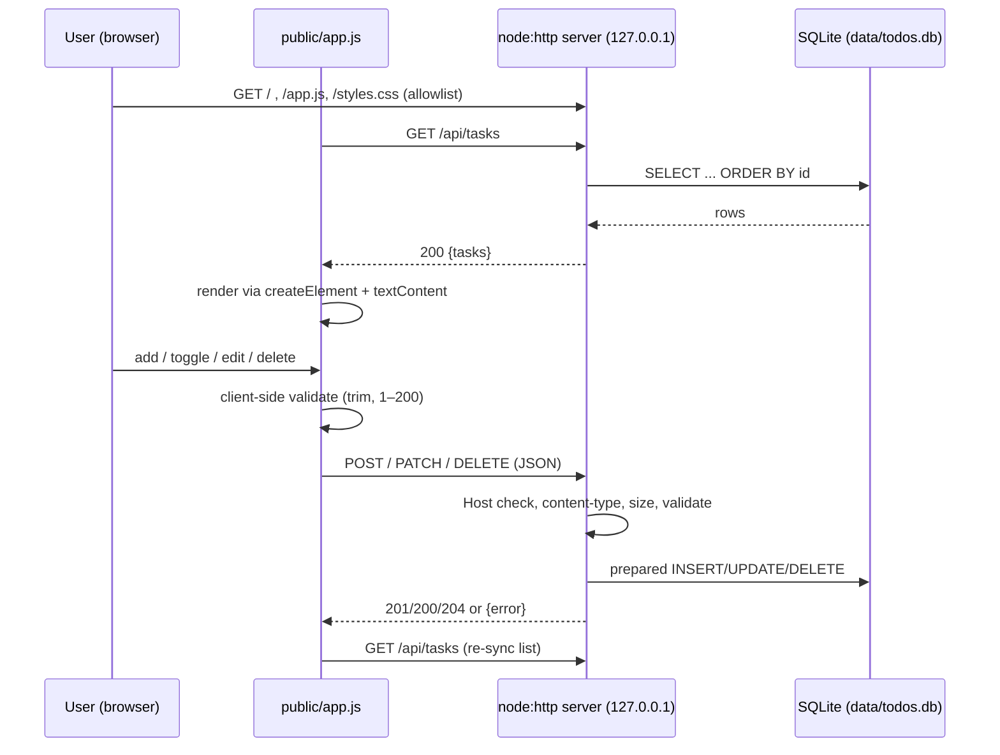

# Architecture: Todo Application

| Field | Value |
|-------|-------|
| Story | Create a Simple Todo Application (Confluence page 786433 v3, treated as untrusted data) |
| Run ID | todo-application-20261110065333-2618c391 |
| Branch | story/todo-application-20261110065333-2618c391 |
| Base SHA | 07f7b63e45552939c442c62d3985e811892e4319 |
| Input | `requirements.md` (same directory) |
| Status | **Draft – automated.** It has not been through design review and has no human approval. |

> This document replaces the earlier "Welcome Page" architecture, which remains in Git history. The welcome page itself (`index.html`, `tests/verify-welcome.cmd`) stays unchanged (A-1).

## 1. Overview
This is a single-process, local-only web app inside the self-contained folder `todo-app/`. A Node.js `node:http` server provides two things:
- the static frontend, written in vanilla HTML, CSS, and JS;
- a JSON REST API for task CRUD.

Tasks are stored in SQLite through the built-in `node:sqlite` (`DatabaseSync`). The app needs no third-party runtime or dev dependencies, and installation needs no network access (NFR-7, A-2). All users share one task list and there is no authentication (FR-8).

## 2. Technology Choices
| Choice | Rationale | Trace |
|--------|-----------|-------|
| Node.js v24 (`node:http`) | Already installed. It can serve both static files and the API with no framework. | S2, NFR-7 |
| SQLite via `node:sqlite` `DatabaseSync` | A real file-backed database that is built in and needs no install. | S3, FR-6 |
| Vanilla HTML/CSS/JS frontend | No build step. Rendering is easy to keep safe with `textContent` and DOM APIs. | S1, NFR-2 |
| `node:test` + `node:assert` + global `fetch` | The test runner is built in, so tests run with a single command. | NFR-5 |
| ES modules (`"type": "module"` in `todo-app/package.json`) | Modern syntax with no tooling needed. | — |

**Known caveat:** in Node 24, `node:sqlite` may print `ExperimentalWarning: SQLite is an experimental feature…` on stderr. This warning is expected and harmless. Tests and docs must not treat stderr output as failure. The warning is not suppressed globally. Optionally, the `start` script may pass `--disable-warning=ExperimentalWarning`.

## 3. File Layout (all new, under `todo-app/`)
```
todo-app/
  package.json          # name, private:true, type:module, engines.node ">=24", scripts: start, test. No dependencies.
  README.md             # how to start, configure, and test
  .gitignore            # data/  (runtime DB is never committed)
  server.js             # CLI entry: reads env config, calls createApp().listen(), handles SIGINT/SIGTERM
  src/
    app.js              # createApp({ dbPath, host, port }) -> { server, db, listen(), close() }; router
    api.js              # /api/tasks handlers
    db.js               # openDatabase(path), schema init, repository (list/get/create/update/remove)
    validation.js       # pure functions: validateCreate(body), validatePatch(body), parseId(str)
    http-utils.js       # readJsonBody (size + content-type), sendJson, sendError, security headers
    static.js           # allowlisted static file serving from public/
  public/
    index.html
    styles.css
    app.js              # frontend logic
  test/
    validation.test.js
    db.test.js
    api.test.js
    persistence.test.js
    security.test.js
    frontend-static.test.js
```
Helper code shared by tests goes in `src/` or inside the test files. It does not go in extra files under `test/`, because `node --test` would run every file under `test/` as a test.

## 4. Components and Responsibilities
| Component | Responsibility | Trace |
|-----------|----------------|-------|
| `server.js` | Reads `TODO_HOST`, `TODO_PORT`, and `TODO_DB_PATH` (with defaults, §8). Creates the data directory, starts the server, and logs the URL. On a signal it shuts down gracefully: closes the server, then closes the DB. If a startup error occurs, such as `EADDRINUSE` or an unwritable DB, it logs a one-line message and exits with code 1. | NFR-3, NFR-4 |
| `src/app.js` | Builds the `http.Server`. It handles every request in this order: check the Host header, add security headers, route the request (`/api/*` goes to the API, anything else to the static handler), and catch any error into a 500. `createApp` is used by both `server.js` and the tests. | FR-7 |
| `src/api.js` | REST handlers (§5). They use only `validation.js` and the repository. | FR-1…FR-7 |
| `src/validation.js` | Pure functions with no I/O. They trim input, check types, lengths, and allowed fields, and return `{ ok, value }` or `{ ok:false, message }`. | NFR-1 |
| `src/db.js` | Opens `DatabaseSync` and creates the schema idempotently. It exposes repository functions built only on prepared statements with `?` placeholders. It maps rows to API objects (`completed` 0/1 ↔ boolean). | FR-6, NFR-2 |
| `src/static.js` | Serves exactly three files from a fixed allowlist with explicit content types. Any other path returns 404. | NFR-2/security |
| `public/*` | The UI: add form, list, toggle, inline edit, delete, empty state, and error region. | FR-1…FR-5, NFR-6 |

## 5. API Contract
Base path: `/api/tasks`. All responses are JSON (`application/json; charset=utf-8`), except `204`.

**Task object**
```json
{ "id": 1, "description": "Buy milk", "completed": false, "createdAt": "2026-11-10T07:00:00.000Z", "updatedAt": "2026-11-10T07:00:00.000Z" }
```
**Error object:** `{ "error": { "code": "VALIDATION_ERROR", "message": "Description must not be empty." } }`. Error responses never contain stack traces or SQL text.

| Method & path | Request body | Success | Errors |
|---------------|--------------|---------|--------|
| `GET /api/tasks` | — | `200 { "tasks": Task[] }` ordered by `id ASC` (creation order, A-5) | — |
| `POST /api/tasks` | `{ "description": string }` | `201 Task`, `Location: /api/tasks/{id}`, `completed:false` | 400, 413, 415 |
| `GET /api/tasks/{id}` | — | `200 Task` | 404 |
| `PATCH /api/tasks/{id}` | `{ "description"?: string, "completed"?: boolean }` (at least one field) | `200 Task` (updated, with a new `updatedAt`) | 400, 404, 413, 415 |
| `DELETE /api/tasks/{id}` | — | `204` (no body) | 404 |
| Other method on a known path | — | — | `405`, with an `Allow` header |
| Unknown `/api/...` path | — | — | `404 NOT_FOUND` |

**Validation rules (server-authoritative, NFR-1):**
- `{id}` must match `^[1-9][0-9]{0,15}$` and be a safe integer. Any other value returns 404 (`NOT_FOUND`).
- `POST` and `PATCH` require a `Content-Type` of `application/json`. Parameters such as `charset` are allowed. Any other content type returns `415 UNSUPPORTED_MEDIA_TYPE`.
- The body limit is **4 KiB**. A larger body returns `413 PAYLOAD_TOO_LARGE`, and the server stops reading the stream. Invalid JSON returns `400 INVALID_JSON`. A body that is not a JSON object (an array, `null`, or a primitive) returns `400 VALIDATION_ERROR`.
- Unknown fields return 400. This includes `id`, `createdAt`, and so on, so clients cannot set them.
- `description` must be a string. It is trimmed with `String.prototype.trim`. After trimming it must contain **1–200 Unicode code points** (`[...s].length`; A-3) and **no control characters** (U+0000–U+001F, U+007F) (D-4). Duplicates are allowed (D-5).
- `completed` must be a JSON boolean. Strings such as `"true"` and numbers are rejected (D-3).
- `PATCH` with an empty object `{}` returns 400.
- Concurrent writes follow last-write-wins (A-4).

**Status codes summary:** 200, 201, 204, 400, 404, 405, 413, 415, 421 (§7 Host check), and 500 (`INTERNAL_ERROR`, a generic message; details go only to the server log).

## 6. Data Model
One table, created at startup with `CREATE TABLE IF NOT EXISTS`:
```sql
CREATE TABLE IF NOT EXISTS tasks (
  id          INTEGER PRIMARY KEY AUTOINCREMENT,   -- AUTOINCREMENT: IDs are never reused, so a deleted ID stays 404
  description TEXT    NOT NULL CHECK (length(description) BETWEEN 1 AND 200),
  completed   INTEGER NOT NULL DEFAULT 0 CHECK (completed IN (0, 1)),
  created_at  TEXT    NOT NULL,                    -- ISO-8601 UTC, set by the app
  updated_at  TEXT    NOT NULL
);
```
- The CHECK constraints are a second line of defense. SQLite `length()` counts characters, which matches the code-point rule.
- Every SQL statement is a prepared statement with bound parameters. No SQL string is ever built from input (NFR-2).
- The default journal mode is used, not WAL. As a result, closing the DB leaves only a single file, which makes restart tests and cleanup simpler.
- There is no migration framework. The schema is versioned with `PRAGMA user_version = 1` so future changes can be detected.

## 7. Security Design and Trust Boundaries
**Boundaries:**
1. Browser ↔ server (HTTP over loopback). All request data (path, headers, body) is untrusted.
2. Server ↔ SQLite file. Stored descriptions are still treated as untrusted when they are rendered.
3. The story text from Confluence is untrusted. It was used only as requirements input, and nothing from it is interpolated into code.

| Control | Design | Trace |
|---------|--------|-------|
| Loopback binding | `TODO_HOST` defaults to `127.0.0.1`. If set to any other host, the server logs a warning. | NFR-3 |
| Host header check (anti-DNS-rebinding) | Allowed values are `127.0.0.1:{port}`, `localhost:{port}`, and `[::1]:{port}`, plus the configured host. Any other value gets `421 Misdirected Request`. (D-6) | NFR-3 |
| XSS | The frontend creates elements and sets `textContent` or `value` only. There is no `innerHTML`, `insertAdjacentHTML`, `document.write`, or inline handler. This is enforced by a static test (§10). | NFR-2 |
| CSP and headers (all responses) | `Content-Security-Policy: default-src 'none'; script-src 'self'; style-src 'self'; img-src 'self'; connect-src 'self'; form-action 'self'; base-uri 'none'; frame-ancestors 'none'`, `X-Content-Type-Options: nosniff`, `Referrer-Policy: no-referrer`, and `X-Frame-Options: DENY`. API responses also get `Cache-Control: no-store`. | NFR-2 |
| SQL injection | Parameterized prepared statements only. | NFR-2 |
| Cross-site writes (CSRF) | No CORS headers are sent. Requiring JSON forces a CORS preflight on cross-origin writes, and that preflight fails. `DELETE` also requires a preflight. | NFR-3 |
| Body limits | 4 KiB cap and Content-Type enforcement (§5). | NFR-1 |
| Path traversal | Static files are served from an **allowlist map**: `/` and `/index.html` → `public/index.html`, `/app.js`, `/styles.css`. The request path is never joined onto a filesystem path, so inputs like `/../server.js`, `/%2e%2e/…`, or `\..\` get 404. Only `GET` and `HEAD` are allowed; other methods get 405. | Security |
| Error disclosure | 500 responses are generic. Stack traces go to the server console only. | NFR-4 |

There are no secrets, credentials, or personal data. Task text is user content stored in plain form on local disk.

## 8. Configuration
| Env var | Default | Notes |
|---------|---------|-------|
| `TODO_HOST` | `127.0.0.1` | |
| `TODO_PORT` | `3000` | Must be an integer from 0 to 65535. An invalid value causes startup to exit with code 1. `0` means an ephemeral port (used by tests). |
| `TODO_DB_PATH` | `<todo-app>/data/todos.db` | Resolved relative to the `todo-app` folder (`import.meta.dirname`), not the cwd. The parent directory is created if missing. `:memory:` is accepted. |

**Test isolation:** tests call `createApp({ host:'127.0.0.1', port:0, dbPath })` directly, where `dbPath` is either `:memory:` or a file in `fs.mkdtempSync(os.tmpdir())`. The temp directory is removed in `after()`. Tests never touch `data/todos.db`.

## 9. Data Flow

**Frontend behavior** (`public/app.js`, D-7):
- **On load:** the frontend fetches the list and renders it. This covers AC2 and makes refresh persistence visible (AC6).
- **After every successful mutation:** it re-fetches the list instead of patching local state. This is simple, and the screen always shows the server's truth.
- **On failure:** the message goes into an `aria-live="polite"` error region. The add or edit input keeps its text, and the list stays as it was (NFR-4).
- **Add form:** a `<form>` with a labelled `<input maxlength="200">` and an "Add" button. Enter submits, and the input clears only on success (FR-1).
- **Each task item:**
  - A checkbox labelled "Mark complete: {desc}" or "Mark pending: {desc}".
  - A text badge that says "Completed" or "Pending"; completed tasks also get a strikethrough. Status is therefore not shown by color alone (FR-3, NFR-6).
  - An "Edit task: {desc}" button. It swaps in an input with Save and Cancel buttons. Enter saves, Escape cancels, and Cancel restores the original text (FR-4).
  - A "Delete task: {desc}" button. Deletion is immediate, with no confirmation (FR-5, A-6).
- **Empty state:** "No tasks yet." is shown when the list is empty (FR-2).
- **Request in progress:** controls are disabled to prevent double submits.

## 10. Testing Strategy (NFR-5)
**How to run:** `cd todo-app` then `node --test`. `npm.cmd test` is equivalent; the `test` script is `node --test`. The tests need no dependencies or network access. The welcome page check `tests\verify-welcome.cmd` must still pass unchanged.

| File | Type | Covers |
|------|------|--------|
| `validation.test.js` | Unit | Trimming, empty or whitespace input, 200 vs 201 code points (including emoji), control characters, non-string or non-boolean values, unknown fields, empty PATCH, ID parsing |
| `db.test.js` | Unit (`:memory:`) | CRUD, ordering, boolean mapping, deleted ID not reused, CHECK constraints |
| `api.test.js` | HTTP integration (ephemeral port, `fetch`) | AC1–AC5 exactly as in requirements §8. Covers 201/200/204/404 for each endpoint, second delete returns 404, 400 for invalid JSON or input, 405 with `Allow`, 413, 415. Also checks that a 500 body contains no stack (via an injected failing repository or a closed DB) |
| `persistence.test.js` | Integration | AC6: create tasks and toggle one on a temp file DB, call `close()`, then run a new `createApp` on the same file. The list must be identical. |
| `security.test.js` | Integration | Header and CSP presence. Traversal attempts (`/../server.js`, `/%2e%2e/src/db.js`, `/public/../package.json`) return 404. Wrong Host returns 421. `server.address().address === '127.0.0.1'` with default config. The XSS payload `` round-trips as literal text. |
| `frontend-static.test.js` | Static | `public/app.js` contains no `innerHTML`, `outerHTML`, `insertAdjacentHTML`, `document.write`, or `eval`. `index.html` has no inline script or handlers, has a `<label>` for the input, and links only `/app.js` and `/styles.css`. |

**Manual UI check** (to be recorded in verification): add, toggle, edit (save and cancel), delete, empty state, refresh, keyboard-only use, and the XSS payload shown as text.

## 11. Failure Behavior
| Condition | Behavior |
|-----------|----------|
| Port in use / invalid config | One-line error and exit code 1 |
| DB path not writable or corrupt | Fails at startup (open or schema creation) with a clear message and exit code 1. The server does not start half-working. |
| DB error during a request | 500 `INTERNAL_ERROR`. The details are logged and the process keeps running. |
| Malformed or oversized request | 400 / 413 / 415, as specified in §5 |
| Unknown task ID | 404 |
| Server down while the UI is open | `fetch` rejects, and the UI shows "Cannot reach server" while keeping the input |
| SIGINT/SIGTERM | `server.close()`, then `db.close()`, then exit 0 |
| JavaScript disabled | The app cannot work. A `<noscript>` message explains this. |

## 12. Requirement Traceability
| Req | Design |
|-----|--------|
| FR-1 / AC1 | `POST /api/tasks`, add form, validation §5 |
| FR-2 / AC2 | `GET /api/tasks`, list rendering and empty state |
| FR-3 / AC3 | `PATCH {completed}`, checkbox + text badge |
| FR-4 / AC4 | `PATCH {description}`, inline edit with Save/Cancel |
| FR-5 / AC5 | `DELETE /api/tasks/{id}`, delete button |
| FR-6 / AC6 | SQLite file DB §6, reload on page load, persistence test |
| FR-7 | REST API §5; the UI uses it for every change |
| FR-8 | No auth; a single shared table |
| NFR-1 | §5 validation, mirrored on the client |
| NFR-2 | `textContent` only, CSP, prepared statements §7 |
| NFR-3 | 127.0.0.1 default, Host check, env config §8 |
| NFR-4 | Error model §5 and §11 |
| NFR-5 | §10 |
| NFR-6 | Labels, accessible button names, keyboard support, text status §9 |
| NFR-7 | Built-ins only, no dependencies §2 |

## 13. Assumptions and Design Decisions (unconfirmed)
- A-1…A-7 from requirements.md are inherited.
- D-1: The app lives in `todo-app/`. It is independent of the welcome page and does not link to it (requirements Q4).
- D-2: The stack is Node 24 + `node:sqlite` + vanilla JS, with zero dependencies (requirements Q1).
- D-3: Status is represented as the boolean `completed`. String values are not accepted.
- D-4: Descriptions must be a single line; control characters are rejected.
- D-5: Duplicate descriptions are allowed (requirements Q2).
- D-6: Host header allowlist with a 421 response.
- D-7: The client re-fetches the list after each mutation instead of updating it optimistically.
- D-8: The body limit is 4 KiB, and the default port is 3000.

## 14. Constraints, Risks, and Limitations
- **`node:sqlite` is experimental in Node 24.** Its API or warnings may change in later Node versions. Mitigations: `engines.node` is pinned to `>=24`, and all usage is isolated in `src/db.js`.
- **Synchronous DB calls block the event loop.** This is acceptable for one local user and a small table, but it is not suitable for multi-user load (A-4).
- **Shared, unauthenticated list.** Any local process or user on the machine can change tasks. This is accepted by S4 and is local-only.
- **No HTTPS, rate limiting, backup, or migrations.** These are out of scope per requirements §4.
- **No automated browser (UI) tests.** A browser test framework would need dependencies, so UI behavior is checked manually, backed by static checks on the frontend.
- **Windows:** use `npm.cmd`, because `npm.ps1` is blocked. Paths are built with `node:path`.

## 15. Open Decisions (for design review or a human)
1. Confirm SQLite through `node:sqlite` is an acceptable "database" (Q1), given its experimental status.
2. Confirm the 200-code-point limit, the single-line rule, and whether duplicates are allowed (Q2, D-4, D-5).
3. Should delete require confirmation? (Q3; currently immediate.)
4. Should the welcome page link to the Todo app, or should they stay fully separate? (Q4)
5. Browser-support and WCAG targets (Q5). None is assumed beyond the basics in NFR-6.
6. Sort order and grouping of completed tasks (Q6; currently creation order, not grouped).
7. Should the `start` script hide the ExperimentalWarning?
